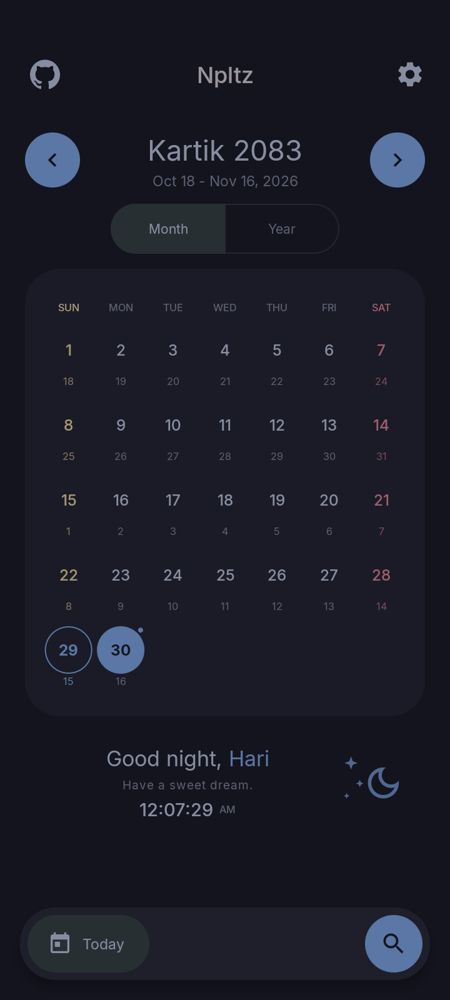
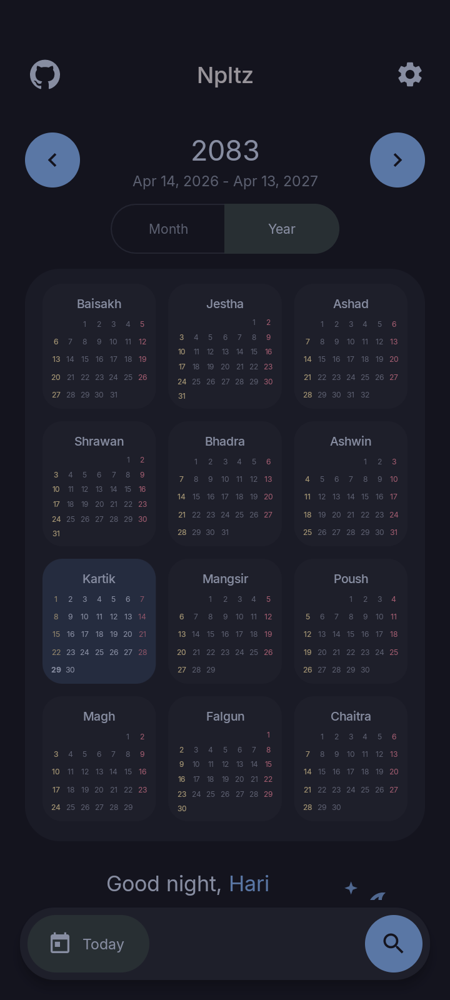
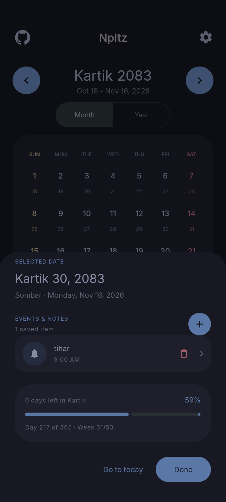
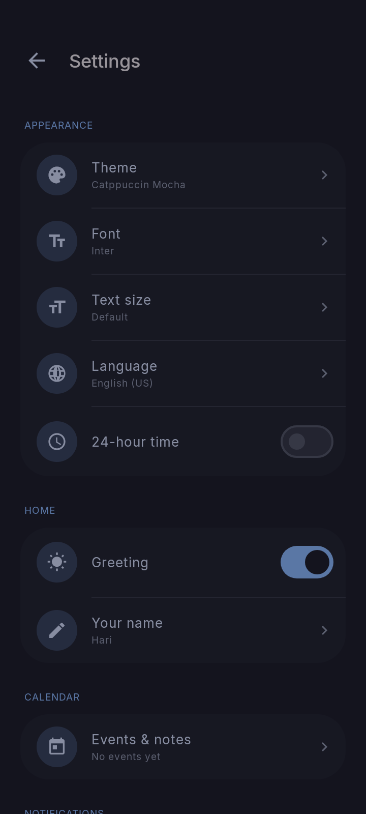
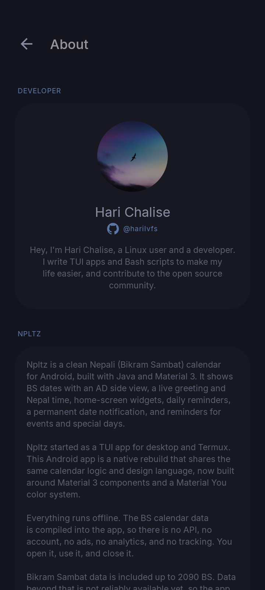
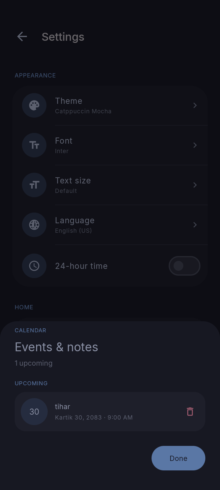
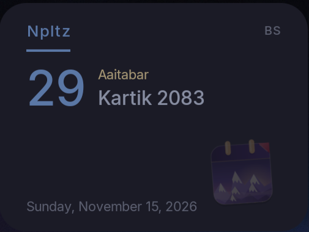
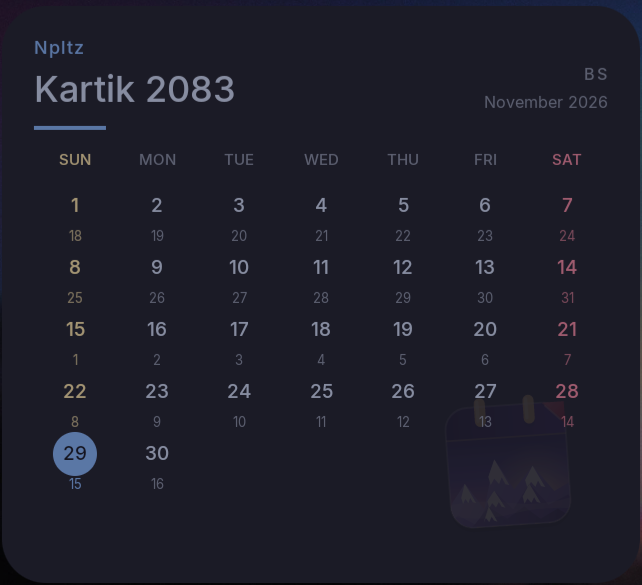

<p align="center">
  
</p>

# npltz for Android

A clean, native Android calendar for Nepali dates (Bikram Sambat). It is driven
by the same calendar data as [npltz](https://github.com/harilvfs/npltz), the
terminal calendar, and brings it to a phone with an offline, simple interface.

This is a full native rebuild in Java around Material 3: a custom calendar
grid, Material You colour and type, and a small set of focused custom views.
It is Kotlin-free, with no ads, tracking or network permission.

## Preview

<p align="center">
  
  
  
</p>

<p align="center">
  
  
  
</p>

<p align="center">
  
  
</p>

<p align="center">
  
</p>

## Features

- Bikram Sambat month and year views, with the matching AD date under each day.
- Tap a day for BS/AD details, week number, days remaining and year progress.
- Swipe or use the arrows to change month; switch between month and year.
- Saturdays in red, Sundays in yellow, and a clear state for today.
- Add events and notes with optional reminder times.
- Past dates cannot receive new events, but existing past events can be edited.
- Search by year, month or full BS date: `2083`, `2083-07` or `2083-07-16`.
- Daily date notification at a chosen time and an optional permanent notification.
- New Year notifications.
- Live Nepal Standard Time clock and a personal greeting on the home screen.
- Date, month and greeting widgets that resize to fit the launcher.
- Material 3 interface: Catppuccin Mocha by default, plus eight themes, three
  fonts, four text sizes and English/Nepali scripts.
- Report bugs from Settings with a GitHub issue or a pre-filled bug report mail.
- Portrait and landscape layouts.

## Download

Npltz is not on F-Droid, Google Play or another app store yet.

Download the latest APK from the
[Releases page](https://github.com/harilvfs/npltz-android/releases/latest) and
open it on your phone. You may need to allow installs from your browser or file
manager.

## Controls

| Action | How |
| --- | --- |
| Change month | Swipe left or right, or tap the arrows |
| Month / year view | Tap the `Month` or `Year` tab |
| Open a day | Tap a date |
| Go to today | Tap `Today` |
| Find a BS date | Tap `Search` |
| Settings, about and links | Tap the gear button |
| Back from year view | Android back, or the `Month` tab |

## Changelog

Release notes are generated with [git-cliff](https://git-cliff.org) from
conventional commits. See [CHANGELOG.md](CHANGELOG.md) for the full history,
and use [conventional commit messages](https://www.conventionalcommits.org)
(`feat:`, `fix:`, `perf:` and so on) so your changes land in the changelog.

## Report a bug

This is my first Android app, so if you find any bugs, please report them.
Open an issue in the
[issue tracker](https://github.com/harilvfs/npltz-android/issues), or use
Settings > Report a bug: the mail option opens your mail app with a bug report
template and your device details already filled in.

## Build

The build script works on Linux, macOS and Windows. You only need the
dependencies installed on your system; the script finds the rest.

### Requirements

- JDK 17 or newer
- Android SDK: platform 35, build-tools 35.0.0 and platform-tools
- `python3`
- `adb` (platform-tools) only if you want to install with `build.py --install`

### Where to get the SDK

- **Arch Linux**: `sudo pacman -S jdk17-openjdk python android-tools`, then
  install the SDK from the AUR (`android-sdk`, `android-sdk-build-tools`,
  `android-sdk-platform-tools`) or with Android Studio's SDK Manager.
- **Other Linux distributions**: install the same packages from your
  distribution's repositories, or use Android Studio.
- **Windows and macOS**: the easiest path is Android Studio's SDK Manager.
  The SDK usually lands in `%LOCALAPPDATA%\Android\Sdk` (Windows) or
  `~/Library/Android/sdk` (macOS), which `build.py` checks by default.

If your SDK lives somewhere else, point `ANDROID_HOME` at the SDK root (the
folder containing `platforms/` and `build-tools/`):

```sh
export ANDROID_HOME="$HOME/Android/Sdk"
export JAVA_HOME=/path/to/jdk-17
```

### Build the APK

```sh
python3 build.py              # build, then dist/npltz-android.apk
python3 build.py --install    # build, then adb install -r on the connected phone
python3 build.py --test       # run the calendar checks only
```

The first build downloads Gradle 8.13 and the Material dependency, generates
the calendar table, runs the JVM tests, and builds the debug APK. The APK is
debug-signed and ready for sideloading.

You can also call Gradle directly:

```sh
./gradlew coreTest apk
```

Expected test output:

```text
calendar core ok (2803 checks)
```

## Data and logic

`data/calendar_data.json` is copied from the
[npltz calendar data](https://github.com/harilvfs/npltz/blob/main/calendar_data.json)
in the Rust project. `tools/gen_calendar_data.py` turns it into the generated
`CalendarData.java` table at build time.

The conversion code in `CalendarLogic.java` is ported from
[npltz/src/calendar.rs](https://github.com/harilvfs/npltz/blob/main/src/calendar.rs)
and uses the same AD epoch (`1918-04-13`) and bidirectional month-table walk.

Npltz for Android is the phone side of the project. It uses Java views,
Material 3 components and the generated table, so the app never parses JSON and
does not need the Rust binary at runtime.

The table covers **1975–2090 BS**. `tools/CoreTest.java` checks the reference
dates from the Rust tests and round-trips the first and last day of every month.

## Notes

- Minimum Android 8.0 (API 26); targets and compiles against API 35.
- Current version: `1.0.0`.
- Fully offline: no network permission, ads, analytics or tracking.
- Events, notes and settings are stored on the device. Clearing app data removes
  them.
- Android 12+ may ask for notification and exact alarm permission for reminders.
- Widgets refresh at midnight and after settings change. Some launchers need a
  resize or re-add after an app update.
- The calendar data covers 1975–2090 BS.
- Typeset in [Inter](https://rsms.me/inter/), under the SIL Open Font License;
  the license text ships with the app in `assets/fonts/Inter-OFL.txt`.
- APKs from Releases are debug-signed. Build with your own release key if you
  distribute a modified build.

## Contributing

You can contribute to Npltz for Android, but be sure you know what you are
contributing. Keep pull requests clear and concise: explain what changed, why it
changed, and how you tested it. Avoid unrelated changes in the same PR. For
larger changes, open an issue first.

To work on the project you need JDK 17+, an Android SDK with platform 35 and
build-tools 35.0.0, and `python3`. Run `python3 build.py` before opening a PR;
it runs the JVM calendar tests and builds the APK. Test the app on a device or
emulator, and include a screenshot or short recording for UI changes.

By taking part, you agree to follow the
[Code of Conduct](.github/CODE_OF_CONDUCT.md).

## License

Copyright (C) 2026 Hari Chalise.

Npltz for Android is released under the
[GNU General Public License v3.0](LICENSE). The original npltz terminal project
is MIT licensed; this Android app is GPL-3.0.

## Support

If you love my work, starring this repo is a support for me. Thank you.

Made with love in Nepal.
